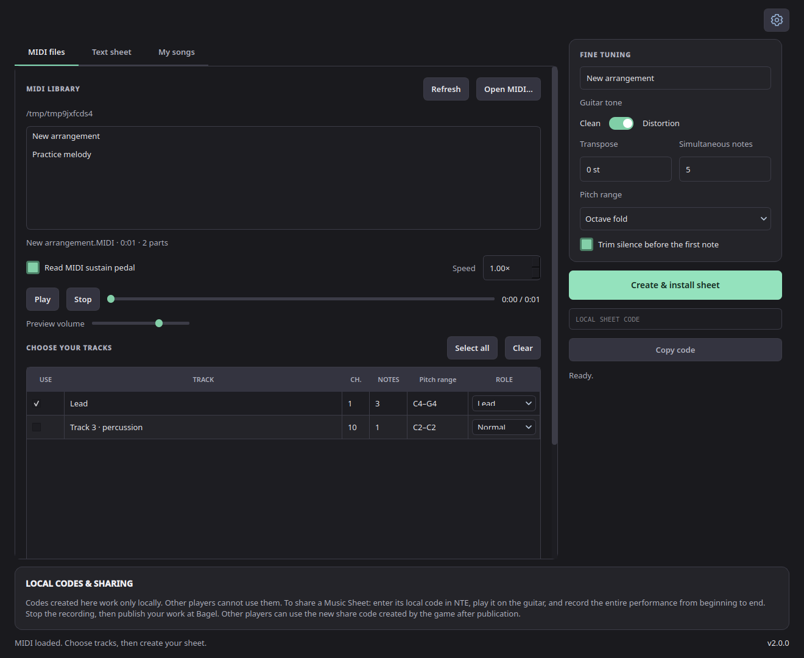
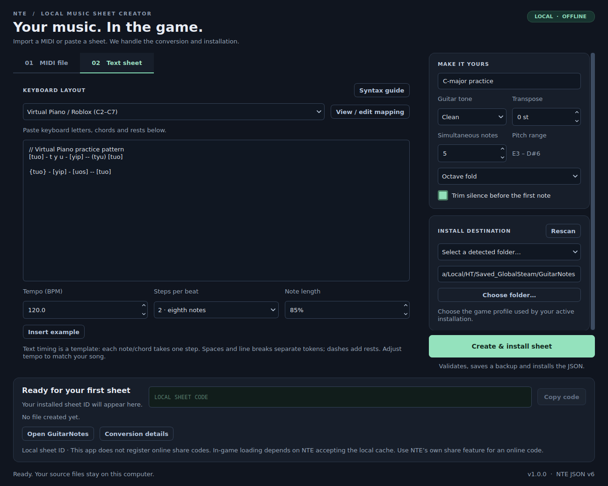

# NTE Local Music Sheet Creator

A local desktop application for creating Neverness to Everness guitar sheets.
The complete interface is in English. Works with Windows NTE installations
and Linux Steam/Proton installations. No account, upload service or API key
is needed. Source music stays on your computer.





## Features

- Two input tabs: Standard MIDI files and Virtual Piano letter sheets.
- Track/channel selection, melody priorities and optional MIDI sustain.
- Virtual Piano, Genshin and NTE keyboard presets plus a custom mapping editor.
- Clean or Distortion tone, transposition, speed and pitch-range fitting.
- Automatic Windows/Steam/Proton destination detection and remembered folder selection.
- Validated NTE v6 JSON, automatic installation, export backups and a copyable local ID.
- No overwriting of existing game recordings.

**The displayed code is a local sheet ID, not a server-registered online share
code.** Local-cache loading must be supported by your installed NTE version.

## Get the project

Download this repository as a ZIP and extract it, or clone it:

```bash
git clone https://github.com/ZenoMetal/NTE-Local-Music-Sheet-Creator.git
cd NTE-Local-Music-Sheet-Creator
```

## Start

### Windows

1. Extract the entire ZIP into a writable folder.
2. Install **Python 3.10 or newer** from <https://www.python.org/downloads/> if needed.
   Enable the Python launcher or “Add Python to PATH”.
3. Double-click **Start Creator.bat**.

The launcher creates a private `.venv` and installs PySide6 on the first run.
That setup needs internet access; normal conversion works offline. It does
not install Python packages into your system Python.

To build a Windows desktop executable, run **build-windows.bat on Windows**.
It produces `dist/NTE Local Music Sheet Creator/NTE Local Music Sheet Creator.exe`. Distribute the whole
output folder. A Windows binary cannot be built and tested from this Linux host.

### Linux / Steam Proton

Run **start-creator.sh**, or open a terminal in this folder and run:

```bash
bash start-creator.sh
```

Python 3.10 or newer is required. The launcher uses an already installed
PySide6 if available; otherwise it creates a private `.venv` and installs it.
Some distributions provide Python's venv component separately (`python3-venv`).
PySide6 needs the normal Qt desktop libraries supplied by your distribution.
For a Qt display-plugin error, launch from a terminal to see the missing library.

You can also run `python main.py` in an environment containing PySide6.

To build a standalone Linux application, run `bash build-linux.sh`.
The result is in `dist/NTE Local Music Sheet Creator/`; keep the whole folder
together. Linux builds depend on the build machine's glibc and Qt environment.
Build on an older supported distribution when targeting older systems.

### Install as a Python package

```bash
python -m venv .venv
# Linux: source .venv/bin/activate
# Windows: .venv\Scripts\activate
python -m pip install .
nte-local-music-sheet-creator
```

## Tab 1 — MIDI file

Drag a `.mid`/`.midi` file into the import area or use **Browse MIDI file**.
The application reads Standard MIDI Files type 0 and type 1, including tempo
changes, multiple channels, note lengths and optional sustain-pedal holds.
It separates parts by track and channel, including MIDI type-0 files.

Select the parts you want. Percussion is excluded. Set important melody parts
to **Lead** so that they take priority over accompaniment when reducing dense
passages. **Speed** changes playback speed; 1× preserves MIDI timing.

The application does not transcribe MP3/WAV audio. MIDI pitch bends, modulation,
velocity dynamics and instrument timbres cannot be expressed in the reference
NTE JSON schema. Notes are rendered using the chosen Clean/Distortion guitar tone.
MIDI type 2 and SMPTE timing are rejected with an explanation. Maximum input
size: 16 MB / 600,000 events / 200,000 selected notes.

## Tab 2 — Text sheet

**Virtual Piano / Roblox** is selected by default.
These letters describe Virtual Piano pitches; they are not pressed as NTE keys.
Each input character is translated to its musical pitch and then to NTE's
`Piano_1` through `Piano_36` range.

Other choices are Genshin lyre, NTE keyboard, and an editable custom mapping.
The mapping editor shows the exact character-to-MIDI-pitch assignments.

### Timing and syntax

| Input | Meaning in this application |
| --- | --- |
| `a b c` or `abc` | Consecutive notes, one step each |
| `[abc]` or `{abc}` | Simultaneous notes, one step |
| `(abc)` | Fast roll; each child uses half a step |
| `([ab]c)` | A chord followed by a note in a fast roll |
| `-` or `\|` | One step of silence |
| `_` | Two steps of silence |
| Spaces / line breaks | Separators, no added time |
| `// comment` | Ignore the rest of the line |
| `\[` `\]` `\-` `\(` | Literal reserved keyboard keys |

Set **Tempo**, **Steps per beat** and **Note length** to match the arrangement.
At 120 BPM and 2 steps per beat, one step lasts 250 ms. Parentheses therefore
use 125 ms per child. Braces are an alias for simultaneous square-bracket chords.
Nested chords and rolls are accepted. A malformed group or unknown key reports
its line and column, instead of silently dropping notes.

Virtual Piano websites use different timing conventions. This app deliberately
uses the explicit rules above: spaces inside `[a s d f]` are ignored, so use
`(asdf)` for a fast sequence. A letter-only sheet cannot reproduce exact original
rhythm without specifying timing. In the Virtual Piano preset, uppercase letters
and shifted symbols select black keys. The literal `(` key (D#3) must be escaped
as `\(` because unescaped parentheses mean a fast roll here.

The Genshin layout is Z–M = C3–B3, A–J = C4–B4, Q–U = C5–B5.
For NTE's keyboard layout, `~` represents the Enter key; `\[` / `\]` and `\-`
represent the corresponding literal NTE keyboard keys.

## Conversion and installation

1. Give the sheet a title, choose **Clean** or **Distortion**, and optionally transpose.
2. Select the detected **GuitarNotes** folder. If several game profiles exist,
   explicitly choose the one used by your active installation. The choice is remembered.
3. Click **Create & install sheet**.
4. After validation and installation, the local sheet ID appears with **Copy code**.

Detected Windows locations:

```text
%LOCALAPPDATA%\HT\Saved_Global\GuitarNotes\
%LOCALAPPDATA%\HT\Saved_GlobalSteam\GuitarNotes\
```

On Linux the app reads Steam's `libraryfolders.vdf`, checks normal and Flatpak
Steam roots and common mounted SteamLibrary folders, then looks inside:

```text
steamapps/compatdata/4508340/pfx/drive_c/users/<user>/AppData/Local/HT/
```

It also checks `WINEPREFIX` and `STEAM_COMPAT_DATA_PATH` when provided. You can
always select or enter another GuitarNotes folder. Run NTE once if no save
profile exists yet. The application does not guess a profile when several exist.

Each conversion receives a fresh 32-character hexadecimal ID and creates:

```text
guitar_note_<ID>.json
```

Existing game sheets are never overwritten. A JSON backup and detailed report
are saved before installation to:

```text
Windows: %LOCALAPPDATA%\NTE Local Music Sheet Creator\exports\
Linux:   $XDG_DATA_HOME/nte-local-music-sheet-creator/exports/
         (default: ~/.local/share/nte-local-music-sheet-creator/exports/)
```

Installation failures show the backup path; the app only reports success after
checking that the copied bytes match the export. Preferences are stored using
Qt's per-user settings. The original MIDI or text input is not modified.

### Pitch fitting

NTE's available keyboard range is **E3–D#6** (MIDI 52–87), inferred from the
user-provided reference recording and in-game keyboard screenshot.

**Octave fold** moves out-of-range notes by octaves, preserving pitch class but
potentially changing voicing. **Drop outside range** omits those notes;
**Reject outside range** stops so you can adjust transposition yourself.
Dense passages are reduced to at most five simultaneous notes, with Lead parts
and then higher notes preferred. Duplicated notes are merged, repeated notes
receive matching releases, and extremely short events (under 25 ms) are omitted.
The conversion report gives the numbers of fitted, merged, omitted and shortened notes.

### Local sheet IDs and online share codes

The displayed code is the installed file's **local `noteId`**. It is **not** a server-registered
online music share code. This application does not contact the NTE server or
upload anything. If the game's import field only accepts server assets, a newly
generated local ID will not download an online sheet. Local-cache loading and
the note mapping must be checked in your installed NTE version. For sharing
across machines/regions, use NTE's own publishing/sharing feature.

NTE JSON format v6 is based on a reference recording; it is not a documented
official API. Generated files are structurally verified, but game playback and
future NTE compatibility cannot be validated by this application.

## Development and tests

```bash
python -m unittest discover -s tests -v
python -m compileall -q main.py nte_studio
QT_QPA_PLATFORM=offscreen python main.py --self-test
```

Tests cover tempo maps, running status, sustain, malformed files, keyboard
mapping, nested notation, range fitting, note pairing, voice priority, path
detection and no-overwrite installation. The actual Qt interface was also
exercised offscreen through MIDI import and text conversion, verified installation
into temporary folders, code copying, and compact-window rendering.

The Windows launcher/build script is supplied but has not been run on Windows.
A Linux build's Qt window and temporary-folder installation passed the packaged
self-test. No test sheets were installed into a real game cache.

## References

- Virtual Piano keyboard mapping and notation: <https://virtualpiano.net/how-to-play/>
- PySide6 / Qt for Python: <https://doc.qt.io/qtforpython-6/>
- NTE JSON: a reference recording and the in-game keyboard layout.

Unofficial community utility. Not affiliated with NTE's developer or publisher.
