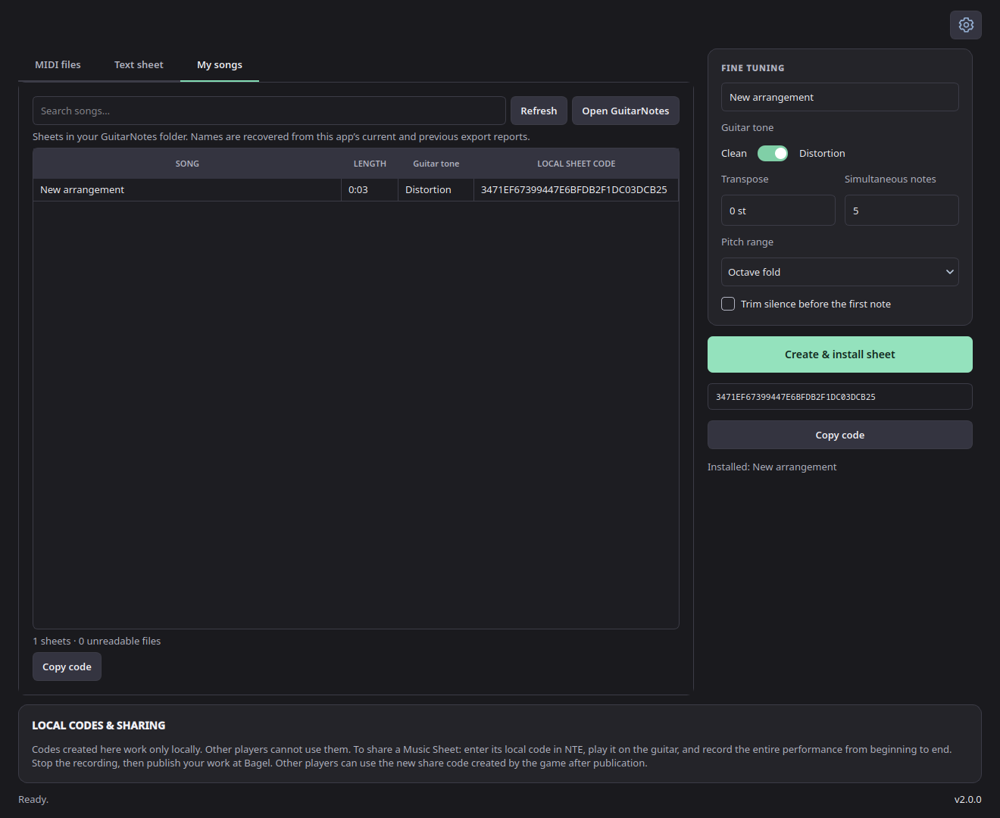
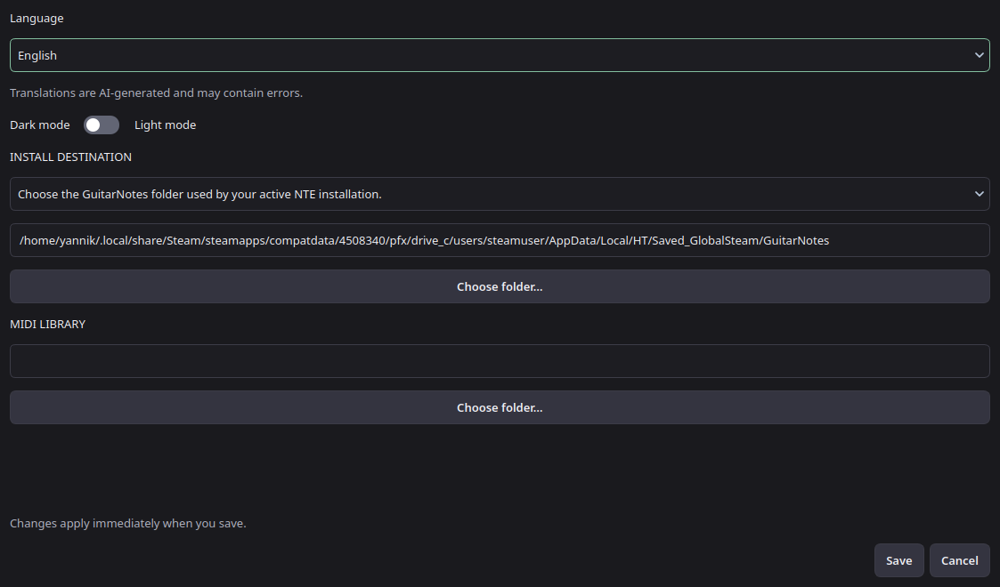

# NTE Guitar Sheet Studio

Create local **Neverness to Everness** guitar sheets from MIDI files or text notation.
Windows and Linux/Steam Proton. No account or API key is needed for normal use.

## Download

Get the **Linux AppImage** or **Windows x64 executable** from
[Releases](https://github.com/ZenoMetal/NTE-Guitar-Sheet-Studio/releases/latest).
The binaries bundle Python and Qt; a separate Python installation is not required.

On Linux, make the AppImage executable and open it. If FUSE is unavailable,
run it with `APPIMAGE_EXTRACT_AND_RUN=1`. On Windows, open the `.exe`.
The Windows executable is unsigned. Published checksums accompany both builds.

## MIDI library and preview


Use the gear at the upper right to select a **MIDI library folder**. Its `.mid`
and `.midi` files appear in a list; click a song to load it. **Open MIDI…** also
opens individual files. Loading a new MIDI automatically replaces the sheet title
with its filename without the extension. You can edit that title before exporting.

Choose parts under **USE** and audition them with **Play/Pause**, **Stop**, seeking and volume.
Changing USE while playing updates the audible parts immediately. Clearing all
parts pauses playback. **Speed** applies to both preview and export.

Preview uses a built-in neutral synthesizer, without a soundfont or external
MIDI player. It plays original note pitches and parsed sustain lengths.
Percussion is excluded. Export pitch fitting, voice priorities, transposition
and the NTE guitar tone do not change the neutral preview sound.

## Text sheets


Paste Virtual Piano notation, Genshin lyre notation, NTE keyboard notation or a
custom character-to-MIDI mapping. Virtual Piano letters describe musical pitches,
not the physical NTE keyboard keys.

| Notation | Meaning |
| --- | --- |
| `abc` or `a b c` | Consecutive notes; one step each |
| `[abc]` or `{abc}` | Simultaneous chord |
| `(abc)` | Fast roll; half a step per child |
| `([ab]c)` | Nested chord and roll |
| `-` or `\|` | One rest step |
| `_` | Two rest steps |
| Spaces / newlines | Separators without added time |
| `// comment` | Comment until the next line |
| `\[` `\]` `\-` `\(` | Literal reserved characters |

Set BPM, steps per beat and note length, or enable **Set target length and
calculate tempo automatically**. Enter minutes and seconds; BPM updates as you
edit. **Steps per beat stays unchanged.** Export uses the exact computed BPM,
not the rounded displayed number. The target includes written rests, before
optional leading-silence trimming and the 0.8 s lead-in / 1.5 s tail.
Impossible targets outside 20–400 BPM are rejected.

## Fine tuning and local installation

The Clean/Distortion slider is **Clean on the left (off)** and **Distortion on
the right (on)**. Set transposition, simultaneous notes (1–5), pitch fitting and
leading-silence trimming in **FINE TUNING**. Then click **Create & install sheet**.
The generated code and **Copy code** button are directly below it.

Choose **INSTALL DESTINATION** inside Settings. Typical Windows folders:

```text
%LOCALAPPDATA%\HT\Saved_Global\GuitarNotes\
%LOCALAPPDATA%\HT\Saved_GlobalSteam\GuitarNotes\
```

Linux detection checks Steam/Flatpak libraries, mounted SteamLibrary folders and
Wine/Proton prefixes, including app ID 4508340. Select the folder used by your
active NTE installation. Existing game recordings are never overwritten.
Validated JSON and a named conversion report are backed up under:

```text
Windows: %LOCALAPPDATA%\NTE Guitar Sheet Studio\exports\
Linux:   $XDG_DATA_HOME/nte-guitar-sheet-studio/exports/
         (default: ~/.local/share/nte-guitar-sheet-studio/exports/)
```

## My songs



The third tab lists sheets actually present in the selected GuitarNotes folder.
Search by song name, tone or local ID, then copy a selected sheet's code.
Titles are recovered from current and legacy export reports from **NTE Local
Music Sheet Creator** and **NTE Sheet Studio**. JSON recordings with no title or
matching export report show an unnamed label and their ID. The app does not
invent missing titles or alter game JSON to store display names.

## Settings, languages and appearance



The gear opens install destination, MIDI library, language and light/dark mode.
English, German, Spanish, French, Japanese and Simplified Chinese are included.
**Translations are AI-generated and may contain errors.** Technical diagnostics
and source track names may retain their original language. Settings apply when
saved. The dark background is **#1A1A1E**. Existing destination, tone and mapping
preferences migrate from previous app names; previous export folders stay intact.

## Local codes and sharing

Codes created by this app are local sheet IDs. Other players cannot use them as
online share codes. To share a Music Sheet:

1. Enter the local code in NTE and play the sheet on the guitar.
2. Record the performance from beginning to end.
3. Stop recording and publish your work at **Bagel**.
4. Share the **new code created by the game** after publication.

The app does not register server assets or upload recordings. The NTE v6 JSON
schema and E3–D#6 (MIDI 52–87) range are based on a reference game recording.
Actual game acceptance depends on the installed game version.

## Source and development

```bash
git clone https://github.com/ZenoMetal/NTE-Guitar-Sheet-Studio.git
cd NTE-Guitar-Sheet-Studio
python -m venv .venv
# Linux: source .venv/bin/activate
# Windows: .venv\Scripts\activate
python -m pip install -r requirements.txt
python main.py
```

Python 3.10+ is supported for source use; release builders use Python 3.12.
The source launchers create a private virtual environment on first use if needed.
**Start Studio.bat** is the Windows launcher; **start-studio.sh** is the Linux
launcher. Old launcher filenames remain as compatibility aliases.

```bash
python -m unittest discover -s tests -v
QT_QPA_PLATFORM=offscreen python main.py --self-test
```

Run `python tools/package.py` on Windows for the single-file `.exe` or on Linux
for AppImage (set `APPIMAGETOOL` to the official AppImage/appimagetool executable).
Install `pyinstaller` and `pillow` alongside requirements. The release workflow
builds and smoke-tests on native Windows and Ubuntu 22.04, then publishes both
assets and SHA-256 files when a `v*` tag is pushed. Manual workflow runs build
artifacts without publishing a release.

MIDI SMF 0/1, tempo maps, running status and sustain are supported. Type 2, SMPTE,
files above 16 MB and excessive event counts are rejected with an explanation.
This application does not transcribe MP3/WAV files. Pitch bends and original
instrument timbres cannot be represented in the reference NTE JSON schema.

Unofficial community utility, not affiliated with NTE's developer or publisher.
See [THIRD_PARTY.md](THIRD_PARTY.md) for runtime licensing.
